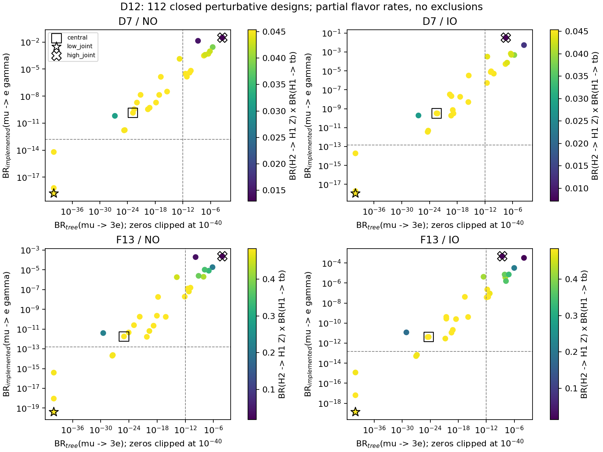

# D12 flavor–collider benchmark audit

Executed 2026-11-03 on `feature/zee-d12-flavor-collider-benchmarks`, descended
from real D11B `ad77620685a1dcf1f4ec1db612f2b3e1eacc8b31`.
**A large implemented LFV signal is not forced by the promising F13 cascade.**
The direct e–mu Yukawa entries can be suppressed inside a closed inverse family
with almost unchanged cascade BRs. Broad unrestricted homogeneous directions
instead raise LFV by many orders and can substantially dilute tb/cascade BRs.
These results establish a conditional flavor-texture effect, not global viability
or a new unavoidable flavor–collider correlation. **Novelty not established.**

## Exact spectra, neutrino inputs and bounded design

Only the two D10 representatives certified at their original full reconstructed
tree potentials are used. The other three D10 representatives retain UNKNOWN.
The historical NO in the D7 name does not restrict its neutrino ordering.

| Spectrum | mH1, mH2 / GeV | full scalar input canonical SHA256 |
| --- | --- | --- |
| D7 = d7_NO_neutral_near_heavy_07 | 298.7266553444879, 532.9329127809378 | ff0c551534e5051f223c00435293403e3b553f52e0cbec4344287da8b3dce862 |
| F13 = F13_heavy_0001330 | 572.2316243593124, 873.2076828282773 | 9117e7af53f9ad5c21f964a7c216de7af5824e903856fed54b9b237c922f4a1d |

The source-locked [JSON](../validation/module12/d12_benchmarks.json) stores four
explicit F,D,Ye,Ye2 witnesses per spectrum/ordering, exact Module2 input and
output hashes, scalar hashes, closure/round-trip residuals, all partial rates,
and the 112-design family table. Central references reproduce the *exact*
D11B input hashes and four Yukawa matrix hashes, checked against its stored
`reference_bestfit` witnesses. New solutions use the same frozen inverse API;
none of D11B's deliberately unstable trials is reused.

There are 28 specified designs per spectrum/ordering: seven F scales
(1e-7,1e-6,1e-5,1e-4,0.001,0.01,0.1), six homogeneous amplitudes
(1e-4,0.001,0.01,0.1,0.3,1) along the normalized complex D11B direction,
twelve seeded complex orientations/phases/charts with coefficient amplitudes
(0,1e-4,0.01,0.1), and three targeted textures at F=(1e-4,0.001,0.01).
Seed=121103 for NO, 121104 for IO, reset between spectra. All four Yukawa
matrices have max element <1; every solution passes the unchanged 2e-9 closure
tolerance. The design extrema are not parameter-space bounds or acceptance
fractions. Finalist reevaluations do not count as additional distinct solutions.

The central nuisance choice is m_lightest=0.01 eV, Majorana phases=(0.7,2.1)
rad. Diverse designs cross the nine D11B nuisance targets (m0=0.001,0.01,0.03;
phases=(0,0),(0.7,2.1),(2.3,0.4)). Oscillation coordinates are the pinned
NuFIT6.1 secondary best-fit-like summaries for each ordering, not a joint
likelihood or even a guaranteed joint minimizer. No ordering preference,
cosmological filter or statistical nuisance prior is imposed.

The optimization objective is the *discrete* minimum of
max[BR_implemented(mu e gamma)/(1.5e-13), BR_tree(mu3e)/(1e-12)] over the 28
designs. These denominators are measured reference scales, not a fit. The
targeted construction solves four real linear conditions D_e_mu=D_mu_e=0
in eight real native homogeneous coefficients, minimizing their Euclidean norm
with complex least squares and requiring norm<0.01. No inverse equation is
reimplemented. This aligns/cancels Yukawa entries, rather than claiming a
symmetry or an untuned generic point. An additional 24 actual ±1% coefficient
perturbations test local sensitivity: **136 distinct executed solutions total**.

## Paired same-input numerical witnesses

All BRs below are dimensionless. Gamma channels are the coherent implemented
subset, three-lepton channels neutral-tree subsets. `numerical zero` means
<1e-45 after imposing the texture, not a meaningful prediction of a full
branching ratio that small. The last column is a numerical closure residual.

| spectrum/order | role / source design | mu e gamma | mu3e tree | tau mu gamma | tau e gamma | BR H2→H1Z | BR H1→tb | BR product | closure |
| --- | --- | --- | --- | --- | --- | --- | --- | --- | --- |
| D7 NO | central / scale_0.001 | 1.387e-10 | 1.511e-23 | 1.512e-13 | 1.102e-16 | 0.045477 | 0.996676 | 0.045326 | 2.11e-16 |
| D7 NO | high_F / scale_0.1 | 6.44e-11 | 1.797e-27 | 7.995e-13 | 3.306e-12 | 0.045427 | 0.686025 | 0.031164 | 8.581e-16 |
| D7 NO | high_joint / hom_1.0 | 0.03113 | 0.0003667 | 1.571e-08 | 2.765e-06 | 0.028075 | 0.460979 | 0.012942 | 1.067e-11 |
| D7 NO | low_joint / texture_0.0001 | 1.561e-19 | numerical zero | 1.512e-11 | 3.798e-14 | 0.045477 | 0.996718 | 0.045328 | 1.104e-15 |
| D7 IO | central / scale_0.001 | 3.232e-10 | 3.407e-23 | 1.735e-13 | 1.909e-15 | 0.045477 | 0.996659 | 0.045325 | 1.525e-15 |
| D7 IO | high_F / scale_0.1 | 1.917e-10 | 4.182e-27 | 2.415e-12 | 3.305e-12 | 0.045408 | 0.614412 | 0.027899 | 1.639e-15 |
| D7 IO | high_joint / scale_1e-07 | 0.03267 | 3.211e-08 | 1.743e-05 | 2.86e-07 | 0.021745 | 0.327190 | 0.007115 | 1.928e-15 |
| D7 IO | low_joint / texture_0.0001 | 1.086e-18 | numerical zero | 1.735e-11 | 2.264e-13 | 0.045477 | 0.996717 | 0.045328 | 2.382e-15 |
| F13 NO | central / scale_0.001 | 1.785e-12 | 8.823e-26 | 1.87e-15 | 1.313e-18 | 0.485020 | 0.997595 | 0.483854 | 9.336e-16 |
| F13 NO | high_F / scale_0.1 | 3.96e-12 | 3.359e-30 | 4.998e-14 | 2.066e-13 | 0.481129 | 0.458852 | 0.220767 | 8.765e-16 |
| F13 NO | high_joint / hom_1.0 | 0.0002341 | 7.777e-05 | 9.074e-11 | 8.461e-09 | 0.228382 | 0.075577 | 0.017260 | 9.202e-12 |
| F13 NO | low_joint / texture_0.001 | 4.031e-20 | numerical zero | 1.87e-15 | 4.509e-18 | 0.485020 | 0.997594 | 0.483854 | 1.432e-15 |
| F13 IO | central / scale_0.001 | 4.159e-12 | 4.771e-25 | 2.146e-15 | 2.338e-17 | 0.485020 | 0.997551 | 0.483832 | 1.814e-15 |
| F13 IO | high_F / scale_0.1 | 1.188e-11 | 7.879e-30 | 1.509e-13 | 2.066e-13 | 0.479689 | 0.381757 | 0.183125 | 1.178e-15 |
| F13 IO | high_joint / scale_1e-07 | 0.0004686 | 2.588e-09 | 2.24e-07 | 1.052e-08 | 0.210457 | 0.065790 | 0.013846 | 1.579e-15 |
| F13 IO | low_joint / texture_0.001 | 1.338e-19 | numerical zero | 2.146e-15 | 2.754e-17 | 0.485020 | 0.997551 | 0.483832 | 2.4e-15 |

Design ranges (112 primary designs, not global bounds):

| group | mu e gamma | mu3e tree | BR product | max closure |
| --- | --- | --- | --- | --- |
| D7 NO | 1.561e-19 – 0.03113 | numerical zero – 0.0003667 | 0.01294 – 0.04533 | 2.342e-11 |
| D7 IO | 1.086e-18 – 0.03267 | numerical zero – 0.0002721 | 0.007115 – 0.04533 | 2.721e-11 |
| F13 NO | 4.031e-20 – 0.0002341 | numerical zero – 7.777e-05 | 0.01726 – 0.4839 | 2.07e-11 |
| F13 IO | 1.338e-19 – 0.0004686 | numerical zero – 0.0001174 | 0.01385 – 0.4839 | 2.322e-11 |

## Decay physics and competing channels

The frozen D4 `native_card → expected_coefficients → nonleptonic/leptons →
complete_total` functions recompute every width, retaining complex couplings,
both helicities, all nine quark pairs, exact unitary CKM and 27 inclusive or
exclusive channels per mother. The general analytic D4 dictionary was checked
against genuine SARAH at generic angles/complex matrices; this is its application
to new D10 inputs, **not a fresh SARAH export**. Source hashes and original native
evidence are checked before use. Every H+ total matches its conjugate; charge
widths are not added together. Same-parent daughters are closed, off-diagonal
photon and tree WZ/Wgamma vanish, and H2→H1A is CP forbidden in this potential.

Gamma(H2→H1Z) is **0.7286971594 GeV (D7)** and **5.8878233904 GeV (F13)**,
independent of leptonic family. At the central reference D7 has open competing
H2→tb=14.30696385 GeV, H1h=0.8783386822 GeV, Wh=0.0837444933 GeV;
WH and WA are closed. F13 has tb=1.1890131835 GeV,
WH=4.6754338447 GeV, H1h=0.3822671720 GeV, Wh=0.0009457117 GeV,
and the barely open WA=0.0015683317 GeV (threshold 872.63835 GeV).
Thus the 2021-style >70% cascade is **not** reproduced at either frozen
point: D7 is about 4.55%, F13 about 48.5%, once all open channels enter.
The scalar potential and its tree-vacuum proof are never deformed.

The complete frozen SM decay card is in JSON: kinematic mt=172.4, mb=4.78 GeV;
Yukawa reference masses run with one-loop piecewise QCD to each mother mass;
alpha_s(mZ)=0.1180. CKM uses exact unitary PDG2024 Wolfenstein construction.
Lepton masses, MW=80.379, MZ=91.1876, v=246.21965 match the frozen records.
These are specified LO inputs, not updated precision quark-mass predictions.
Off-shell channels, daughter finite widths and QCD/EW corrections remain absent;
the tiny WA width is especially threshold-sensitive.

Charged leptonic BRs below list (e nu, mu nu, tau nu), summed over three
massless tree neutrinos and both orthogonal helicities, for the same witnesses:

| group | role | H1 leptonic BRs (e,mu,tau) | H2 leptonic BRs (e,mu,tau) |
| --- | --- | --- | --- |
| D7 NO | central | 5.44e-06, 1.846e-05, 2.14e-05 | 1.324e-08, 5.023e-08, 5.21e-08 |
| D7 NO | high_F | 0.03744, 0.127, 0.1473 | 0.0001322, 0.0004485, 0.0005201 |
| D7 NO | high_joint | 0.4612, 0.0761, 0.0002439 | 0.3283, 0.05417, 0.0001666 |
| D7 NO | low_joint | 5.445e-08, 2.924e-06, 2.179e-07 | 1.611e-10, 1.461e-06, 2.636e-09 |
| D7 IO | central | 1.391e-05, 1.847e-05, 2.986e-05 | 3.384e-08, 5.576e-08, 7.272e-08 |
| D7 IO | high_F | 0.08573, 0.1137, 0.1841 | 0.0003379, 0.0004483, 0.0007256 |
| D7 IO | high_joint | 1.15e-05, 0.6684, 0.003303 | 8.935e-06, 0.5193, 0.002566 |
| D7 IO | low_joint | 1.392e-07, 4.088e-06, 3.092e-07 | 3.85e-10, 2.082e-06, 6.383e-09 |
| F13 NO | central | 1.41e-05, 4.791e-05, 5.548e-05 | 9.717e-08, 3.36e-07, 3.823e-07 |
| F13 NO | high_F | 0.06487, 0.2201, 0.2552 | 0.0009639, 0.00327, 0.003791 |
| F13 NO | high_joint | 0.5996, 0.3237, 0.0009882 | 0.3433, 0.1853, 0.0005635 |
| F13 NO | low_joint | 1.41e-05, 4.803e-05, 5.548e-05 | 9.717e-08, 3.471e-07, 3.822e-07 |
| F13 IO | central | 3.606e-05, 4.798e-05, 7.743e-05 | 2.484e-07, 3.426e-07, 5.335e-07 |
| F13 IO | high_F | 0.138, 0.1831, 0.2963 | 0.002457, 0.00326, 0.005276 |
| F13 IO | high_joint | 1.599e-05, 0.9295, 0.004592 | 9.693e-06, 0.5633, 0.002783 |
| F13 IO | low_joint | 3.606e-05, 4.811e-05, 7.743e-05 | 2.484e-07, 3.545e-07, 5.335e-07 |

## Signed LFV subset, interference and texture sensitivity

Module4 is called with the genuine Module2 output. It includes the frozen
Module3 scalar one-loop terms **once**, all coherently validated fermion/photon
and physical charged-scalar/photon Barr–Zee terms, both complex chiralities.
All Wgamma candidates are excluded. Zgamma, WZ and other missing EW pieces
are uncomputed. Exact one-loop accuracy remains UNKNOWN (external-invariant
expansion and massless neutrinos); two-loop mass/Yukawa inputs retain Module4's
explicit nominal unmatched card. Light-quark loops are illustrative perturbative
terms, not a hadronic precision calculation. No older approximate LFV assembly
is promoted to a full rate. Missing amplitudes can destructively interfere, so
these rates are **neither lower nor upper bounds** on the full theory.

Each JSON finalist retains every signed CL/CR component and isolated component
rate. The table groups amplitudes by topology *before* squaring. The signed
interference is between the three groups; within-group interference is already
included in their squared rates. Coherence ratio uses the sum of all individual
isolated diagram-row BRs in its denominator, not the grouped rates.

| group | role | one-loop BR | fermion BZ BR | charged BZ BR | signed cross BR | coherent BR | coherence ratio |
| --- | --- | --- | --- | --- | --- | --- | --- |
| D7 NO | central | 3.467e-18 | 1.497e-10 | 2.101e-13 | -1.117e-11 | 1.387e-10 | 1.606 |
| D7 NO | low_joint | 1.561e-19 | 4.825e-39 | 6.771e-42 | 1.097e-29 | 1.561e-19 | 0.0003491 |
| D7 IO | central | 7.211e-18 | 3.488e-10 | 4.894e-13 | -2.604e-11 | 3.232e-10 | 1.606 |
| D7 IO | low_joint | 1.086e-18 | 3.38e-39 | 4.743e-42 | 6.009e-29 | 1.086e-18 | 0.0003539 |
| F13 NO | central | 2.489e-20 | 2.088e-12 | 1.189e-14 | -3.147e-13 | 1.785e-12 | 1.759 |
| F13 NO | low_joint | 4.031e-20 | 1.019e-43 | numerical zero | -1.948e-32 | 4.031e-20 | 1.116 |
| F13 IO | central | 1.024e-19 | 4.865e-12 | 2.77e-14 | -7.336e-13 | 4.159e-12 | 1.759 |
| F13 IO | low_joint | 1.338e-19 | 6.786e-43 | 3.863e-45 | 4.819e-31 | 1.338e-19 | 1.062 |

At fixed orientation, increasing F reduces the required particular D as 1/F.
This suppresses the approximately linear-in-D Barr–Zee transition until the
charged F†F term grows like F² in amplitude. Both chiralities prevent treating
that balance as a single real cancellation. Homogeneous coefficients can instead
increase unconstrained charged flavor couplings without raising neutrino masses.
The texture cancels the two *direct* e–mu entries. Residual tau-mediated
one-loop terms and F†F remain. This is an algebraically selected texture,
not evidence that all flavor observables vanish or that a protecting symmetry
exists. Very large homogeneous directions also involve large cancellations in
the neutrino forward mass; their actual closure is checked, not assumed.

Actual ±1% rescaling of all texture coefficients (holding F and target fixed):

| group | base texture | mu e gamma range (±1%) | mu3e tree range (±1%) |
| --- | --- | --- | --- |
| D7 NO | texture_0.0001 | 1.387e-12 – 1.387e-12 | 3.669e-24 – 3.809e-24 |
| D7 NO | texture_0.001 | 1.369e-14 – 1.406e-14 | 7.29e-28 – 7.379e-28 |
| D7 NO | texture_0.01 | 4.534e-15 – 8.249e-15 | 1.646e-29 – 1.648e-29 |
| D7 IO | texture_0.0001 | 3.231e-12 – 3.232e-12 | 1.557e-23 – 1.595e-23 |
| D7 IO | texture_0.001 | 3.203e-14 – 3.261e-14 | 3.362e-27 – 3.373e-27 |
| D7 IO | texture_0.01 | 1.634e-14 – 2.207e-14 | 3.948e-29 – 3.95e-29 |
| F13 NO | texture_0.0001 | 1.779e-14 – 1.791e-14 | 4.276e-25 – 4.413e-25 |
| F13 NO | texture_0.001 | 1.732e-16 – 1.838e-16 | 6.4e-29 – 6.566e-29 |
| F13 NO | texture_0.01 | 3.398e-16 – 4.452e-16 | 5.722e-32 – 5.767e-32 |
| F13 IO | texture_0.0001 | 4.147e-14 – 4.172e-14 | 1.464e-24 – 1.498e-24 |
| F13 IO | texture_0.001 | 4.077e-16 – 4.242e-16 | 1.84e-28 – 1.877e-28 |
| F13 IO | texture_0.01 | 1.103e-15 – 1.265e-15 | 1.248e-31 – 1.256e-31 |

These are directional finite perturbations, not a full tuning measure in the
eight-dimensional coefficient space. The exact tree zero is texture-specific;
neighborhood results quantify how quickly it is lifted. The 0.001 textures
retain reduced muon subsets at these percent perturbations, while direct entries
at smaller F can be more sensitive. No radiative stability/RG claim is made.

All five Module3 tree channels are evaluated for the 16 finalists with
24/48-order phase-space quadrature and the unchanged 2e-5 relative-change check.
The amplitude has both ordered contractions with their Fermi minus sign; the
identical-particle 1/2 is in phase space after coherent squaring. Scalar
propagators and final lepton masses are retained. Photon/Z penguins, dipole
exchange and boxes could interfere. Selected low-joint witnesses give:

| group | tau3e tree | tau3mu tree | tau mu ee tree | tau e mumu tree | delta GF_mu/GF (F subset) | g_tau/g_mu squared minus 1 (F subset) |
| --- | --- | --- | --- | --- | --- | --- |
| D7 NO | 2.817e-23 | 8.066e-16 | 1.115e-20 | 2.107e-18 | 1.178e-10 | 5.562e-10 |
| D7 IO | 3.039e-22 | 1.202e-15 | 2.31e-20 | 1.642e-17 | 1.178e-10 | 2.155e-09 |
| F13 NO | 4.883e-28 | 2.898e-21 | 1.985e-25 | 7.639e-24 | 2.945e-09 | 1.39e-08 |
| F13 IO | 3.582e-27 | 6.859e-21 | 2.78e-25 | 9.466e-23 | 2.945e-09 | 5.388e-08 |

Universality is only the frozen scalar F contribution (including the muon-GF
subtraction). D and mixed terms are missing. No universality or tau experimental
acceptance is assigned. Large partial widths/BRs in extreme examples are
diagnostic using fixed experimental lepton-width normalizations, not a
self-consistent global fit of lifetimes.



The figure shows all 112 actual designs, with color equal to the recomputed
cascade × tb BR product. Dashed lines are published measured muon limits used
as diagnostic scales. They do not divide full-theory allowed/excluded regions.
Exact-texture tree zeros are clipped to 1e-40 for plotting only.

## Measured references, conditional B→Xs gamma and production

References verified online on **2026-11-03**:

- MEG II 2021–2022 data: measured BR(mu→e gamma)<1.5e-13 at 90% CL,
  [arXiv:2504.15711v2](https://arxiv.org/abs/2504.15711v2), revised 30 July 2025,
  EPJC85 (2025)1177 with erratum EPJC85 1317; retained in
  [PDG2026 muon listing](https://pdg.lbl.gov/2026/listings/rpp2026-list-muon.pdf),
  pp.5–6 (PDF created 1 June 2026). This is not the older 3.1e-13 combined result
  or the projected 6e-14 sensitivity.
- The same PDG2026 listing retains the measured SINDRUM Bellgardt et al.,
  NPB299 (1988)1 limit BR(mu→3e)<1e-12 at 90% CL. No projected Mu3e limit used.
- [PDG2026 meson summary p.132](https://pdg.lbl.gov/2026/tables/rpp2026-sum-mesons.pdf)
  gives measured inclusive b→s gamma=(3.49±0.19)e-4. Review: F. Takahashi et al.,
  IJMPA41 (2026)2630011; PDF created 1 June 2026. The stated error is the
  experimental average's uncertainty, not a theory error for this backend.

The official SuperIso v5.0 archive was downloaded afresh, with original SHA256
`7f8400e98ae80deac50af64486b980891e1630d729a0a4660ca309a4d7706b5f`.
Every distributed original source and every patched source byte is checked
against D9B's stored manifests; the exact tracked D9B patch is applied in
ignored D12 storage only. No previous audit or fork is overwritten. A newly
built client replays the SM, 550/900 one-state and coherent two-state D9B rates;
ordinary Q1–Q8 matching is checked. Each actual D10 charged mass is also checked
native versus independently injected one-state rate at its own tanbeta before
the two-state execution. C4/7/8 are ordinary NDR, no extra alpha_s multiplication,
weights=(cos²gamma,sin²gamma), a single coherent injection. Mu0=160 GeV,
running mt(mu0)=163.16587299291515 GeV; E_gamma>1.6 GeV and original mu_b/defaults.
NLO QCD matching/evolution/numerator retain legacy EM/power/semileptonic
prescriptions. Independent physical-rate accuracy is NOT_CERTIFIED; no NNLO or
certified 2026 global flavor likelihood is inferred.

| spectrum | tanbeta | BR legacy NLO | difference from measured central | relative difference | family repeat difference |
| --- | --- | --- | --- | --- | --- |
| F13_heavy_0001330 | 5.308 | 0.0003887 | 3.967e-05 | 11.365% | 0.0 |
| d7_NO_neutral_near_heavy_07 | 1.116 | 0.0004226 | 7.363e-05 | 21.096% | 0.0 |

The positive differences identify conditional tension worth resolving, especially
for D7, without a sigma pull or mass cut: no source-matched theory uncertainty
was assigned. The original Type-II quark parameters/mixing fix these predictions;
NO/IO and leptonic homogeneous coefficients do not enter the backend command.
Repeated executions have zero rate difference and every same-scalar witness
links the identical rate. This factorization is not a new flavor correlation.

**13.6 TeV and 14 TeV production: NOT_EXECUTED; sigma and sigma×BR=null.**
The exact D10 MG5 runtime/UFO/generated process/PDF/card artifacts are absent
from this checkout, and no authenticated historical rate matches these complete
mass/mixing/tanbeta inputs. D5/D6's 700-GeV 5FS rates do not apply to 532.9 or
873.2 GeV; no F14 number or mass interpolation is substituted. The tabulated BR
products are ready to multiply an independently executed matching rate. No
detector efficiency, HL-LHC sensitivity or exclusion follows.

## Publishing outcome and limitations

[Florentino, Romão, Silva 2021](https://arxiv.org/abs/2106.08332) already studied
the H2→H1Z→tbZ cascade and tbH production; their Sec.7.7 reports BR>70% examples.
Here the exact tree-vacuum-certified D10 points instead give 4.55%/48.5%, with
explicit competing H1h/tb/WH channels. We add actual NO/IO inverse-family
flavor subsets and demonstrate how direct e–mu textures preserve those BRs.
This is a quantitative benchmark difference, not a new cascade mechanism.

[Herrero-García et al. 2017 v2](https://arxiv.org/abs/1701.05345v2) already scans
general Zee neutrino and LFV correlations, including radiative/trilepton modes.
Its Sec.3.3 and Sec.4 have particular approximations, textures, naturality choices
and fit data. Our IO targets have sin²theta23=0.5499, versus NO=0.4701, and
both close here; that algebraic observation with *partial* flavor cannot refute
their constrained fit or ordering conclusions. We have not reproduced their
same-input full rates or parameter restrictions. No comparable likelihood or
quantified literature-wide novelty claim is made.

The original central references show diagnostic muon-dipole tension even when
their cascade product is large. Suppressing the direct e–mu texture removes that
particular tension in the implemented subset with negligible cascade dilution.
Quantitatively, central→low-joint reduces BR_implemented(mu e gamma) by
8.95/8.47 orders for D7 NO/IO and 7.65/7.49 orders for F13 NO/IO. The paired
BR products change by only +0.00408%/+0.00558% and
−0.0000131%/−0.0000141%, respectively. Percent coefficient perturbations at
F=0.001 give muon dipole subsets of 1.37–1.41e-14/3.20–3.26e-14 (D7 NO/IO)
and 1.73–1.84e-16/4.08–4.24e-16 (F13 NO/IO), with tree mu3e below 3.4e-27.
Large F/homogeneous couplings can dilute the cascade product, but the low-LFV
textures keep an almost unchanged product: these two fixed spectra do **not**
establish an unavoidable loss of the collider signal from flavor. Nor is the
hard-production independence of lepton Yukawas a novel correlation.

A modest EPJC paper would require completing the missing LFV amplitudes and
non-dipole interference (especially Wgamma), matched independent flavor-rate
validation and theory uncertainties, exact D10 production with matched PDF and
scheme/scale variations, and a direct same-input comparison to the 2017/2021
analyses. A robust flavor-imposed change of the collider population or a new
testable hierarchy must then be demonstrated; a flat hard rate and selected
textures alone do not establish it. Detector work would be needed for reach.
HiggsTools/search coverage, quantum vacuum and RG remain unresolved.

`COMPLETE_LFV=false`, `2026_GLOBAL_FLAVOR_FILTER_READY=false`,
`global_zee_acceptance=null`, `mass_exclusion=null` everywhere. D10 is a
tree-level statement only. Numerical tolerances are not theoretical errors.

## Reproduction and checks

```bash
python3 -m module12.study
curl -fLsS https://superiso.in2p3.fr/download/superiso_v5.0.tgz -o /tmp/d12-superiso_v5.0.tgz
python3 scripts/zee_d12_superiso.py --archive /tmp/d12-superiso_v5.0.tgz
python3 -m module12.report
python3 -m unittest discover -s tests -p 'test_module12_*.py' -v
git diff --check
```

Detailed trial, sensitivity, reconstructed source/build and backend output logs
remain ignored under `validation/module12/local/`. The compact evidence retains
their hashes, source manifests and reproducible input recipes. Only Modules12,
its script/tests/evidence and the local-output ignore rule are new; Modules0–11
and their audits remain unchanged. Executed test outcome is recorded separately
in the completion log after checks.
